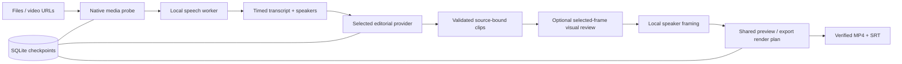

# Architecture and operating boundaries

## Data flow

## Time and editing

Transcripts and crop keyframes use absolute source seconds. `MediaTimeline` converts ranges to CMTime and remaps intersecting timed words onto output time, including discontiguous recuts. The compositor used by playback and native H.264/AAC export is identical. Caption styles and sentence selections do not invoke editorial inference again.

## Jobs and storage

The main actor owns observable queue state. Heavy work runs through actors and an isolated speech executable; one source processes at a time. SQLite serializes JSON checkpoints and usage records in a transaction. The initial schema is version 1; future incompatible data changes must add migrations. Source files and final exports are user-owned; removing a library record does not delete them.

After a successful library save, two rotating atomic job snapshots are stored in the project's private `Recovery` directory. They contain the job's transcript, configuration, usage and stage state, but not original media or Keychain credentials. Existing projects receive a snapshot on load. If a single job row cannot be decoded, the latest valid matching snapshot is loaded and the user is notified. A damaged database file as a whole is not automatically replaced. Startup and resume check unresolved provider journals even if a recovered checkpoint was not marked running.

Model-generated clip decisions are validated against timed speech boundaries. Every request has a journal written before transmission and a completed response cache. An unresolved pending journal is an explicit unknown outcome; cached completed responses are reused without another paid call. Usage UUIDs are stable across replay, and cumulative spend is applied across both editorial and visual stages. Prices are estimates supplied by the user; unknown costs require disclosure and opt-in.

Gemini 3.7/3.8 Flash requests use low thinking and a 16,384-token output allowance. A confirmed `MAX_TOKENS` response can be retried once at 32,768 tokens, with the same input and provider and after checking the remaining estimated budget. A previously cached 4,096-token response is reused if complete, or retained and escalated if truncated. Unknown request outcomes, safety blocks and other errors are not automatically retried. Unknown-price opt-in cannot enforce a spending ceiling. Explicitly choosing current AI connections for a failed stage keeps the existing transcript and source preset.

## Network boundary

Cloud traffic occurs only for configured providers and explicitly selected stages. Keys are retrieved from Keychain immediately before requests. Requests reject redirects and credential-bearing URLs; remote endpoints require HTTPS, while loopback local endpoints may use HTTP. Cloud response bodies are not copied into user-visible error messages. The downloader receives a URL as an argument without shell interpolation and ignores ambient downloader configuration.

## Native models and heuristics

ASR uses FluidAudio or WhisperKit. Speech model execution and optional diarization happen in EdwardMediaWorker; cancellation stops owned processes. Speaker framing associates visible mouth motion with diarized speech, with full-frame fallback when evidence is ambiguous. That association is a heuristic and needs validation for each content style; it is not identity recognition.

## Intentional differences from Cloth

- Original native UI using the supplied black/green/white/amber system.
- Independent provider profiles and local speech; no Setapp runtime or payment dependency.
- Native caption renderer and explicit source-time render plans.
- Conservative preservation of screen/ambiguous visual content instead of automatically cropping unrelated objects/hands.
- Additional square/wide outputs, SRT sidecars, persistent batch recovery and explicit request-cost controls.
