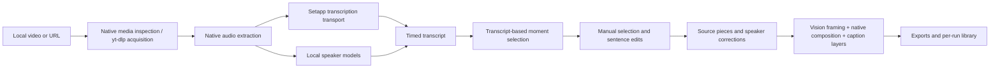

# Cloth native investigation

This is a source-bound investigation of the installed Cloth 0.1.0, build 12, conducted on 2026-10-29. It supplies behavioral contracts for an independently written app. It does **not** establish full functional equivalence, recover the original source project, or verify server behavior.

## Scope and evidence coverage

The bundle inventory covers all 92 regular files and 43 directories, with per-file SHA-256 values in [cloth-manifest.json](cloth-manifest.json). The main binary is universal arm64/x86_64. The native investigation uses the arm64 slice whose identity is in [analysis-target.json](analysis-target.json); the x86_64 implementation has not been independently decompiled. The original installed bundle was not modified.

The supplied REA checkout is version 6.5.0 at `ba98130049fa40ade66b03611ff70c7ddc011a1d`. All 30,106 paths were classified: authored source 2,253; documentation 192; generated output 1,861; VCS 58; tests 2,111; dependencies 23,502; website 129. Architecture, operating instructions, relevant Apple/native workflows, and provider implementation paths were reviewed. Recursive inventory is not a claim that every generated file, test, or dependency received semantic review.

Ghidra 12.1.4 identified 45,579 procedures, 57,249 defined strings, and 57 segments. The explicitly selected application-code neighborhood yielded **4,995 successful decompilations out of 4,995 requested**. Its scope is recorded in ignored `evidence/bulk-decompile-scope.json`. This selection can include compiler helpers and library code; it is not a proof that all Cloth functions lie inside that neighborhood. Selected functions received 12 richer dossiers and six bounded traces. Swift nominal metadata yielded 193 `Cloth` types with fields and metadata accessors from 1,603 type-table entries, with no parser errors. See [swift-type-fields.json](swift-type-fields.json).

The complete native Evidence export contains 106 records. A reusable REA snapshot retains 13 primitive and 54 workflow entries plus those 106 records. Both are ignored local artifacts under `evidence/`. A snapshot caches eligible exact observations; it is not an original-source archive or a complete reusable Ghidra project. The exported receipt's `unknowns: 0` means no formal question records were registered in that session; it does not mean this investigation has no unknowns.

## Recovered processing architecture

The diagram combines metadata, native code, packaged examples, and [runtime UI observations](runtime-observations.md). It does not imply that this investigation executed a paid processing run.

| Subsystem | Source-bound native finding | Important limit |
|---|---|---|
| Input acquisition | `0x10038c07c` builds yt-dlp format choices. One branch prefers AVC1 at height ≤1080, then broader AVC1/MP4 fallback. Other branches build AV1/VP9 alternatives. The three quality names belong to `Cloth.YtDlp.Quality`. | Quality demonstrably affects source download selection. Every quality-dependent export setting is not established. |
| Audio preparation | `0x10021e194` creates AVAssetReader/Writer paths with 16 kHz mono PCM preparation and 32 kbps AAC/M4A output constants. `0x100385350` uses AVAssetExportSession and rejects a video with no audio. | Exact long-file chunk overlap and all path-selection conditions remain unproven. The writer cited here is audio preparation, not proof of the video export implementation. |
| Transcription | `0x10033d7a8` logs v2 processing in one request. `0x10033cba4` checks cancellation/error cases before a branch logging fallback to v1 in chunks. | Actual network payloads, server defaults, pricing, and retries were not replayed. |
| Provider selection | Curation pipeline functions `0x1003122b8`, `0x100314c90`, and `0x1003178bc` reference `openai/gpt-5-mini` and same-transcript/settings cache reuse. | UI and code support the disclosed route, but no request was captured. Generic SDK model strings do not establish additional supported app features. |
| Editorial contract | `0x1002ffc1c` assembles the transcript-selection instructions, count/duration inputs, and a multi-speaker preference. A native tagged Swift-string reference links the instruction literal to this function even though basic string xrefs were empty. | Optimized Swift pseudocode does not recover reliable source variable names. Edward uses its own prompt and validates provider output independently. |
| Speaker models | Four packaged CoreML models and FluidAudio metadata support local diarization. Native logs describe continuing without speaker labels after failure and skipping this path on macOS 14 because of a known CoreML crash. | A packaged model and an error path do not prove transcription accuracy, on-device timing, or compatibility of newly acquired model versions. |
| Visual analysis | `0x100293820` references Vision face rectangles, human rectangles, and body-pose requests. `0x100368620` and `0x1003699b0` use face rectangles and face landmarks. Crop functions at `0x10028b054`, `0x10028c328`, `0x10028d6f0`, and `0x10028ead4` have crop-plan logging. | Exact association thresholds and all ambiguous-speaker behavior remain incompletely resolved. Edward intentionally preserves the full frame when association is uncertain. |
| Native video composition | `0x100387c48` uses 1080×1920 geometry and AVVideoCompositionLayerInstruction. `0x10038969c` builds CALayers and AVVideoCompositionCoreAnimationTool for captions. | These code paths support native rendering; they do not prove every final codec, HDR conversion, frame-rate rule, or failure-recovery path. |
| Caption safety | `0x100371248` loads three platform tables and combines maxima through `0x100364000`. Top/bottom/leading/trailing/crop fields are represented in metadata. | Shipped measurements are historical facts, not guarantees about current platform controls. |
| Persistence/editing | JobRecord, clip pieces/dropped/tightened, transcript cache, curation memo, speaker corrections, and recut state are represented in metadata and examples. | Storage atomicity, all migrations, and cache eviction are not proven solely by declarations. |

The static caption table uses the following values, interpreted as pixels in the 1080×1920 composition. Raw field addresses and the source hash are in [caption-safearea-facts.json](caption-safearea-facts.json).

| Platform | Top | Bottom | Leading | Trailing | Crop |
|---|---:|---:|---:|---:|---:|
| Instagram Reels | 230 | 300 | 48 | 176 | 48 |
| TikTok | 225 | 240 | 48 | 170 | 48 |
| YouTube Shorts | 190 | 220 | 48 | 172 | 48 |

Each table's shipped `measured` flag is true. That flag is not an independent measurement by this investigation. Its source-string pointer uses chained fixups and was left undecoded in the compact supplemental table.

## Evidence references

[evidence-index.json](evidence-index.json) maps every retained result to its exact local artifact, hash, operation, authority, confidence, and limitations. Useful native anchors are:

- Overview: `ev_f65f99d0ab7fc842b1b085ee3baa98510e6f739ddad01f8e5dbfa7252321c8e9`.
- Dispatch inventory: `ev_f0929cc682beca3692e33a00f2e129e28f07259d09d29cc58d80557d93917719`.
- Editorial prompt dossier: `ev_eb5dfc0a628d8a64be1c6105e4749ed6a12973f7cd951375bb295658e7fa85a5`.
- Acquisition quality dossier: `ev_5abfc04f9973876ec5ff8bb3f021ec6e5efbd1ef4367f760c32698826e8bc40d`.
- Visual detection dossier: `ev_4c192881a390849b32501d1fad4a3ba3009b8a5e315f2442f22191c670ee026d`.
- Transcription fallback dossier: `ev_deb8a17c6c5970cf5d1363f4fa7113c4afd2a9ed8d01dc2fe3c2fad1e475f09d`.

## Tool limits and remaining work

REA rejects this universal Mach-O for Ghidra rather than silently choosing a slice, so `lipo` made an ignored arm64 analysis copy. The default Objective-C Message Analyzer stalled; a retained JVM thread dump identifies it. That analyzer was disabled in the final profile. Dynamic Objective-C resolution and Swift async/generic/witness relationships are consequently incomplete. The dispatch report explicitly marks partial or unsupported facets. Six action traces are bounded static address-based traces with depth/node/edge limits, not complete UI-to-network executions. Missing xrefs never establish dead code.

No Setapp credit was purchased or consumed. Original AI calls, a fresh original export, difficult live failures, and original long-form performance remain unverified because the observed account had zero credits. Encryption keys, tokens, user media, cached transcripts, and account databases were not sought. Metadata exports use an allowlist; raw code and literal material remains ignored research evidence and is not linked into Edward. Original resources and demo media were not copied into the app.

Close research obligations only with specific evidence and corresponding reconstructed behavior validation. The checklist in [feature-obligations.json](feature-obligations.json) is deliberately a human assessment, not a fabricated authenticated REA closure ledger. Final workflow confidence must include Edward tests and genuine user footage; numerical inventory coverage is not functional parity.
